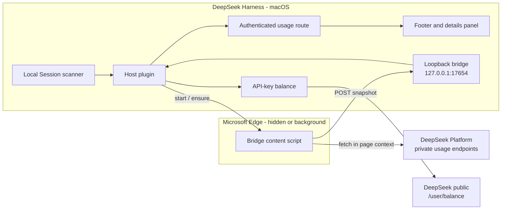

# Token Usage Dashboard

[](LICENSE)
[](package.json)
[](docs/architecture.md)

Official and local DeepSeek usage, spend, balance, API keys, and models in a persistent DeepSeek Harness footer.

## Overview

Token Usage Dashboard adds a full-width status bar to DeepSeek Harness and keeps
two independent accounts of model usage:

- **Official Platform** — the DeepSeek Platform ledger across every API key and
  device on the account, including request counts, spend, balance, per-key
  usage, and model totals.
- **Local DSH** — this machine's durable Session logs and a USD list-price
  estimate, including the local provider and model registry.

The official view is fed by a small Edge content script. DeepSeek's Platform
usage endpoints are protected by an AWS WAF JavaScript challenge; a valid saved
token still receives `202 x-amzn-waf-action: challenge`. The bridge runs the
request inside the signed-in Platform page, where the browser has already solved
the challenge, and posts only the resulting metrics to a loopback Host route.

> **Status: active prototype.** The official bridge and badge were verified live
> on 2026-11-03. The clean-cycle hidden-Edge launch and the post-reload
> completion of the all-time scan still need an independent live check. See
> [Verification](docs/verification.md).

## Architecture



The official and local planes are deliberately separate: the footer prefers the
official ledger when the bridge is fresh and falls back to local DSH values
otherwise. See [Architecture](docs/architecture.md) for the endpoint and failure
model.

## Capabilities

- Persistent `shell.bottom` footer with today's tokens/spend, balance, all-time
  spend/tokens, and the connected API/model count.
- Expandable details for official today/all-time totals, request counts,
  per-key usage, all-time model usage, balance, and the local DSH breakdown.
- Official bridge refreshes current usage about every 30 seconds; the Host UI
  polls every 5 seconds. All-time history is collected in consecutive 30-day
  windows and filled progressively.
- Balance fallback through the Harness credential service and the public
  DeepSeek `/user/balance` endpoint when the bridge is unavailable.
- Always-on switch persisted in browser `localStorage`; the collapsed state
  leaves a compact launcher.
- On macOS, the Host attempts to maintain the Edge context automatically: it
  starts a hidden Edge with background throttling disabled when Edge is not
  running, or opens a background Platform tab when Edge is already open.

## Quick Start

### Prerequisites

- macOS with DeepSeek Harness desktop. Tested with `0.2.1-rc.5`.
- Microsoft Edge, signed in to `https://platform.deepseek.com`.
- One-time Edge extension installation.
- Node.js 24 only for the test suite; the runtime uses the Harness runtime.

### Install the DSH bundle

From this checkout:

```bash
git clone https://github.com/huaqing0617-wang/token-usage-dashboard.git
cd token-usage-dashboard
dsh plugin --profile desktop add "link:$PWD"
```

Select the new bundle in the DSH plugin manager if it is not selected
automatically, then restart the DSH window once.

### Install the Edge bridge once

1. Open `edge://extensions`.
2. Enable **Developer mode**.
3. Choose **Load unpacked** and select the `edge-bridge/` directory in this
   checkout.
4. Reload the `https://platform.deepseek.com/usage` tab once.
5. Restart DSH. The footer should move from `Local` to `Official` within one
   sync cycle.

The extension runs only on `platform.deepseek.com` and posts only to
`127.0.0.1:17654`. It does not export cookies or the Platform user token to
another server.

## Repository Map

| Path | Role |
|---|---|
| `index.js` | Host plugin: local scan, live event ingest, API-key balance, Host model registry, bridge state, authenticated route |
| `client.js` | Browser UI: footer, official/local details, always-on switch, styles |
| `usage.js` | Local token accounting, inherited-event exclusion, day buckets |
| `pricing.js` | Local USD estimate, peak/off-peak rule, 2026 holiday table |
| `bridge.js` | Loopback ingest server and snapshot validation |
| `edge-bridge/` | Manifest V3 Edge extension |
| `edge-bridge/content.js` | Current-window and all-time 30-day-window collector, balance, bridge POST |
| `docs/architecture.md` | Data flow, endpoints, failure states, automatic Edge lifecycle |
| `docs/verification.md` | Test matrix, live evidence, and unverified paths |
| `SECURITY.md` | Data boundaries and private vulnerability reporting |
| `CONTRIBUTING.md` | Contribution and local-verification expectations |
| `test/` | Node smoke tests for the client, extension, and bridge |

## Verification

```bash
npm test
```

The suite currently covers syntax checks, the browser plugin factory and both
slot registrations, the 5-second UI refresh, official/local rendering, the
collapsed launcher, the bridge token/CORS/normalization path, and the
extension's current-window plus rolling all-time aggregation.

Live evidence, commands, and the items that remain unverified are recorded in
[docs/verification.md](docs/verification.md). In particular:

- The official bridge and badge were observed live.
- The private monthly endpoints were WAF-challenged; the collector now uses the
  already-proven consecutive 30-day by-key endpoint.
- No GitHub Actions workflow is included, so there is no CI badge or claim.
- A clean Edge-closed auto-start cycle has not been independently repeated.

## Limitations and Roadmap

- **Edge remains required.** DSH can start or background it, but the Platform
  WAF context is a browser context. A pure DSH-only implementation would need an
  embedded browser layer and is not part of this version.
- **Private endpoints.** The Platform usage API is not a documented public API;
  its responses may change. The collector fails closed to local data.
- **Update cadence.** The UI polls every 5 seconds, but official Platform data is
  fetched about every 30 seconds. Five-second Platform polling is intentionally
  not used because it is more likely to trigger the WAF and exceed the
  Platform's own update cadence.
- **All-time scan.** History is assembled from consecutive 30-day windows,
  stopping after three empty windows (maximum 48 windows). The first scan may
  take minutes and is shown as a syncing notice.
- **macOS only auto-start.** The automatic hidden-Edge launch is a macOS Host
  path. Other shells can still use the extension and a manually managed
  Platform tab.
- **No CI workflow.** Tests are reproducible locally; no workflow has been
  executed.

## Contributing

Open an issue before changing a data source or the official collector, then run
`npm test`. See [CONTRIBUTING.md](CONTRIBUTING.md) for the scope and security
checklist.

## Security

Browser credentials stay in the Platform page. The bridge accepts only
loopback traffic with a local ingest token, and the Host never exposes the
Platform token to the client. See [SECURITY.md](SECURITY.md) for data boundaries
and vulnerability reporting.

## License and Acknowledgements

Released under the [MIT License](LICENSE).

DeepSeek Harness and DeepSeek Platform are products of DeepSeek. This project is
not affiliated with or endorsed by DeepSeek. It relies on private Platform
dashboard endpoints that may change without notice.

References:

- [DeepSeek Models & Pricing](https://api-docs.deepseek.com/quick_start/pricing/)
- [Get User Balance](https://api-docs.deepseek.com/api/get-user-balance/)
- [2026 State Council holiday notice](https://www.gov.cn/gongbao/2025/issue_12406/202511/content_7048922.html)
