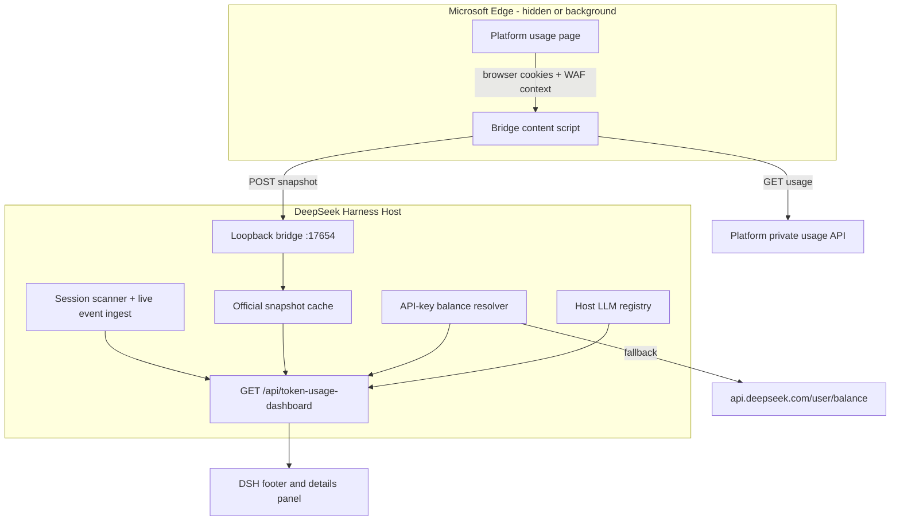

# Architecture

## Purpose

The dashboard has two independent data planes. They answer different questions
and are intentionally not merged into one number:

| Plane | Source | Scope | Currency |
|---|---|---|---|
| Official | DeepSeek Platform private usage endpoints, fetched inside the signed-in Edge page | All API keys on the account; usage may originate from any device | Platform currency, normally CNY |
| Local | DSH durable Session logs on this machine | This DSH profile only | USD estimate at published list prices |

The footer prefers the official plane when the bridge snapshot is fresh. Local
values remain available when the bridge is disconnected and provide the DSH-only
breakdown.

## Data Flow

## Official Collection

The content script runs only on `https://platform.deepseek.com/*` and uses the
existing Platform web session. It fetches:

| Endpoint | Use |
|---|---|
| `GET /api/v0/users/get_user_summary` | Recharge and bonus wallet balances |
| `GET /api/v0/usage/by_api_key/amount` | Tokens and request counts for one 30-day window |
| `GET /api/v0/usage/by_api_key/cost` | Spend and per-key cost for one 30-day window |

A current 30-day window is fetched every 30 seconds. The all-time history is
assembled backwards in consecutive 30-day windows:

1. Merge the current window.
2. Move the window end back 30 days and fetch the previous window.
3. Continue until three consecutive windows contain no tokens, requests, or
   cost, or until the 48-window safety cap (four years) is reached.
4. Post a preliminary snapshot, then progressively richer snapshots, then a
   final snapshot marked complete.

Each window and each parsed aggregate is written to `chrome.storage.local` with
a six-hour cache. A window that still receives a WAF challenge is retried with
exponential backoff and reported in a bounded `syncErrors` list.

### Why Not the Monthly Aggregate Endpoints?

The Platform also exposes monthly aggregate paths. In the first live run those
paths returned `202 x-amzn-waf-action: challenge` for older months, while the
by-key 30-day path succeeded. The collector therefore uses the endpoint already
proven in this browser context instead of a partly blocked monthly path.

### Why a Browser Bridge?

Direct requests from the DSH Host, even with a valid Platform user token, are
challenged by AWS WAF. The missing ingredient is a real browser page that has
already executed the challenge and carries the browser's Platform context. The
extension runs there and posts only derived metrics to loopback. It does not
send the Platform token to DSH.

## Automatic Edge Context

On macOS the Host makes one best-effort attempt when no bridge snapshot has
arrived 35 seconds after plugin activation:

- If Edge is not running, the Host starts Edge with background timer throttling
  disabled, opens the Platform usage page, and hides the Edge process.
- If Edge is already running, the Host opens a background Platform tab with
  `open -g` and does not hide the user's browser.

The attempt is limited to once per Host session. If the Platform tab is closed
later, the official plane becomes stale and falls back to local values until the
Tab is reopened. This is deliberate: repeatedly forcing tabs or hiding an
already-running browser would be intrusive.

The extension installation itself is a one-time manual action. An Edge process
is still required even when DSH starts and hides it; this is not a browser-free
implementation.

## Freshness and Failure States

| State | Meaning | UI behavior |
|---|---|---|
| `ready` | Snapshot received within two minutes | Official badge and values |
| `stale` | Last snapshot is older than two minutes | Last official values plus a sync warning |
| `disconnected` | No snapshot | Local values and bridge setup guidance |
| `complete: false` | All-time window scan is still running or had failed windows | Syncing notice; partial official totals |
| `syncErrors` | One or more window reads failed | Bounded error count and first three entries |

The 5-second UI interval is independent of the 30-second official fetch. This
keeps local counters responsive without multiplying WAF-sensitive requests.

## Security Boundaries

- The Platform page token and cookies remain in the browser.
- The bridge listens only on `127.0.0.1:17654`.
- The bridge requires a local ingest token and allows the Platform origin and
  extension origins.
- The authenticated dashboard route is protected by the DSH connection service.
- API-key balance resolution happens in the Host; the key is never sent to the
  client.
- The bridge snapshot contains usage aggregates and wallet balances, not
  credentials.
